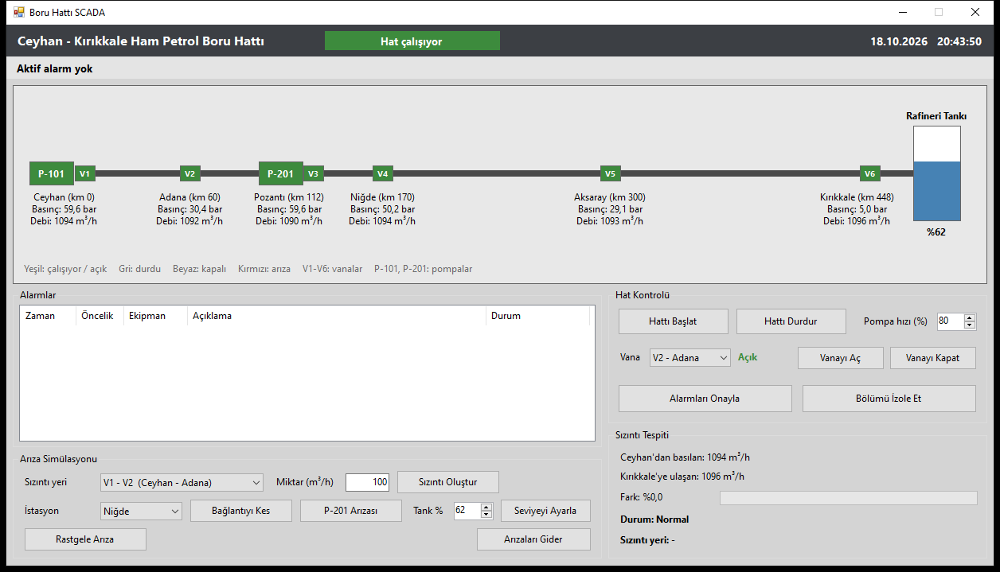
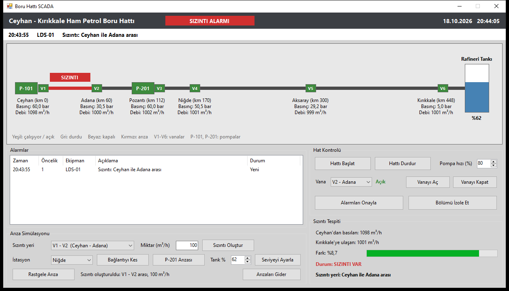

# Ceyhan - Kırıkkale Ham Petrol Boru Hattı SCADA

İleri Düzey Programlama dersi ara sınav projesi olarak C# Windows Forms ile yaptığım SCADA arayüzü.

Ceyhan'dan Kırıkkale Rafinerisi'ne giden 448 km'lik ham petrol boru hattını örnek aldım. Hatta iki pompa istasyonu (Ceyhan P-101, Pozantı P-201), altı vana istasyonu ve hattın sonunda rafineri tankı var. Gerçek sensör olmadığı için debi, basınç ve tank seviyesi değerleri program içinde Timer ve Random ile üretiliyor.

## Neler yapılabiliyor

- Hattı başlatma / durdurma, pompa hızını değiştirme
- Vanaları açıp kapatma
- Her istasyonda basınç ve debi takibi, rafineri tankının seviyesi
- Giriş ve çıkış debisini karşılaştırarak sızıntı tespiti, sızıntının hangi iki istasyon arasında olduğunu bulma
- Sızıntılı bölümü izole etme (pompalar durur, bölümün iki yanındaki vanalar kapanır)
- Alarm listesi: yeni alarmlar yanıp söner, "Alarmları Onayla" ile durur
- Arıza simülasyonu: sızıntı oluşturma, istasyonla bağlantıyı kesme, P-201 arızası, tank seviyesi ayarlama, rastgele arıza

## Alarmlar

| Ekipman | Ne zaman |
|---|---|
| LDS-01 | Giriş-çıkış debi farkı 5 saniye boyunca %1'i geçerse (sızıntı) |
| BASINÇ | Kapalı vana yüzünden basınç 78 bar'ı geçerse, pompalar durur |
| P-201 | Pozantı pompası arızalanırsa |
| TANK | Tank %95'i geçerse, pompalar durur |
| TANK-H / TANK-L | Tank %85'in üstünde / %20'nin altında |
| V1 - V6 | Vana kendiliğinden kapanırsa |
| İstasyon adı | İstasyonla haberleşme koparsa |

## Çalıştırma

`BoruHattiScada/BoruHattiScada.sln` dosyasını Visual Studio ile açıp F5 ile çalıştırabilirsiniz. Proje .NET Framework 4.7.2 kullanıyor, Visual Studio 2017 ve sonrası ile açılıyor.

Derlemeden denemek için zip dosyasının içindeki `BoruHattiScada.exe` doğrudan çalışır.

## Dosyalar

- `BoruHattiScada/` : Visual Studio projesi. Bütün kodlar `AnaForm.cs` içinde.
- `2112705020_YankiCilingir_SCADA_Rapor.pdf` : proje raporu
- `2112705020_YankiCilingir_SCADA_Proje.zip` : teslim edilen proje dosyası (exe dahil)

Basınç değerleri, alarm sınırları ve vana yerleri temsilidir. Hat uzunluğu, istasyonlar ve normal debi (yaklaşık 1100 m³/h) gerçek hattan alınmıştır.

Yankı Çilingir - 2112705020
